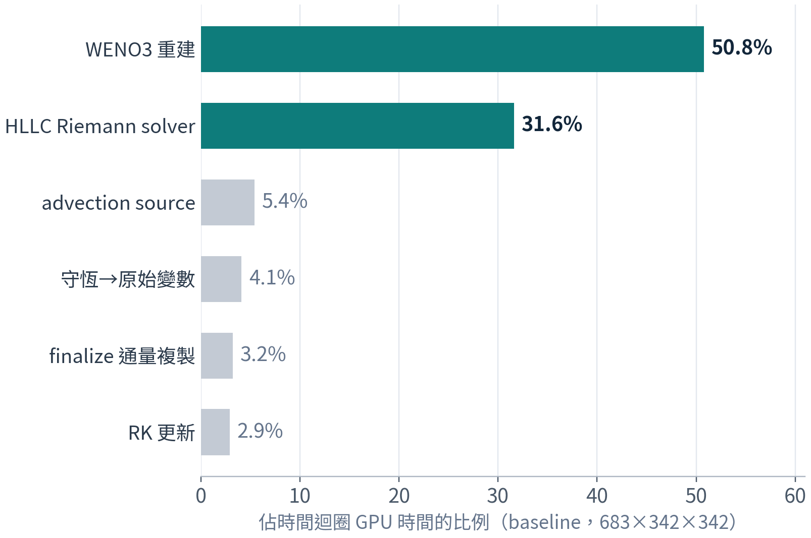
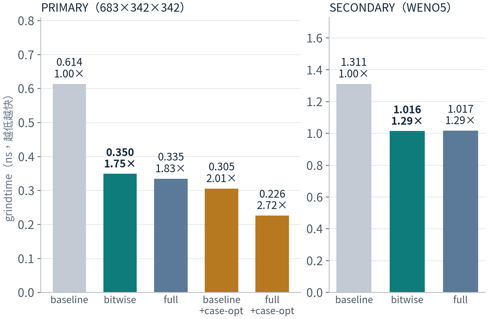
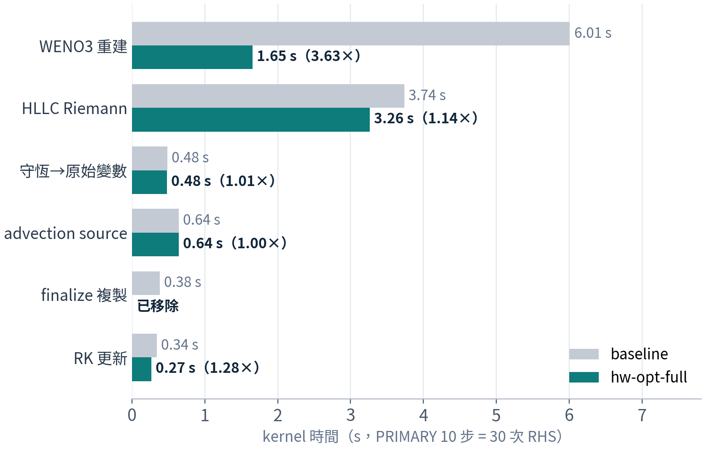

# MFC 在 NVIDIA H200 上的 GPU 效能優化報告

Coding-Adv-HW｜作者：moneychen168｜程式：MFC（Multi-component Flow Code）v5.7.1｜平台：國網 Nano，NVIDIA H200 單 GPU｜編譯器：NVHPC 26.3（OpenACC）

repo：<https://github.com/moneychen168/Coding-Adv-HW-MFC>（branch `hw-opt` = 優化後的 MFC 原始碼，比較檢視 `hw-baseline...hw-opt`；tags `hw-baseline`、`hw-opt-bitwise`、`hw-opt-full`）

> 本報告引用的 commit hash 都是 repo 上 `hw-opt` 歷史的發佈版：各 lane 的 commit 以 noreply 作者地址重新發佈，檔案內容相同、hash 不同。E1、B5 只存在於本機，未發佈到 repo。

> 本報告所有數字取自 `results/B/summary.md`、`results/C/results.tsv`、`results/A/` 的原始 log、`results/final/`、`BUILD_RECIPE.md` 與 `AGENT_LOG.md`；不做估計。
> **兩種量測要分清楚**：第 7 節的「per-lane A/B」是各 lane 在自己的較小網格與節點上做的前後對照，用來判斷單一改動的效果；第 9 節的主表是最終設定在同一節點、同一網格上重新量測的結果（`results/final/`）。

## 摘要

- **頭條結果（hw-opt-bitwise，輸出與原版逐位元相同）**：PRIMARY（3D 震波撞擊水滴，683×342×342）grindtime 0.61386 → 0.34998 ns，**1.75×**；SECONDARY（viscous、WENO5，577×289×289）1.31108 → 1.01565 ns，**1.29×**。同一 H200 節點交錯執行，各 3 次取中位數（`results/final/`）。
- **hw-opt-full**（再加 B3）：PRIMARY 0.33472 ns，1.83×，**輸出不是逐位元相同**：以場最大值正規化的最大差 6.2e-11（y、z 動量），逐點相對差（只計 |值| > 場最大值 1e-6 的格點）最大 3.4e-6，出現在動量過零點附近。SECONDARY 上 B3 無作用（1.29×，逐位元相同）。
- **加上上游 `--case-optimization`**：hw-opt-full + case-opt 0.22604 ns，**2.72×**；其中上游功能單獨（baseline + case-opt）為 2.01×，我們的改動在其上再貢獻 1.35×。
- **正確性**：regression 子集（hw-opt-full）riemann_solver=2 45/45、weno_order=3 9/9、weno_order=5 22/22、3D 232/232；完整套件：704 passed / 0 failed / 61 skipped（共 765；`$WORK/results/final/logs/test_full.log`，EXIT=0）。
- **主要優化**：B1（WENO3 private 陣列純量化，per-lane −35.1 %）、C1–C4（HLLC 直接寫通量、RK 一格一執行緒、放寬 inline 上限、EOS 捷徑，per-lane 累計 −7.5 %）、B2（−1.1 %）、B4（WENO5 −32.2 %）、B3（−3.6 %，非逐位元）。優化後 WENO3 kernel 快 3.63×，HLLC 成為最大熱點（49.9 %）。
- **負面結果**：全域 maxregcount 無增益、逐檔 maxregcount 無法 link、helper 改 public 無效果、B4 對 WENO3 無增益；E1、B5 未驗證完、未整合。
- **做法**：一個主 agent（Fable 5.2）只做決策與派工，四條平行 lane（A build/baseline/profile、B kernel 優化、C build/runtime 與 Riemann/time stepper、D 交付物）由 Opus 5.5 與 Fable 5.2 實作（第 11 節）。

## 0. 符號與名詞

| 符號 / 名詞 | 定義 |
|---|---|
| MFC | Multi-component Flow Code，本作業優化的可壓縮多相流求解器 |
| grindtime | MFC 官方效能指標：每格點（gp）、每方程（eq）、每次 RHS 計算的平均耗時，單位 ns；越低越快（定義見 4.2） |
| RHS | right-hand side，半離散方程 ∂q/∂t = RHS(q) 的右手邊項 |
| sys_size | 方程數（守恆變數個數） |
| m, n, p | x、y、z 三個方向的格點數（MFC 內部以最後一格的索引表示） |
| WENO | Weighted Essentially Non-Oscillatory，高階、不產生非物理震盪的格面重建方法 |
| HLLC | Harten–Lax–van Leer–Contact 近似 Riemann solver |
| RK3 | 三階 Runge–Kutta 時間積分，每個時間步做 3 個 stage（3 次 RHS） |
| OpenACC | 以編譯器指令把迴圈搬到 GPU 的程式模型；MFC 透過 Fypp macro 產生這些指令 |
| Fypp | Fortran 用的 Python 前處理器，MFC 用它做 metaprogramming |
| NVHPC | NVIDIA HPC SDK（nvfortran 編譯器） |
| nsys | NVIDIA Nsight Systems，時間軸 profiler |
| lane A/B/C/D | 本作業的四條平行工作線（第 11 節） |
| B1–B4、C1–C4 | lane B、lane C 各自保留的優化 commit（第 7 節）。lane C 的 `results.tsv` 內部編號不同：tsv 的 C4 / C5 = 本報告的 C3 / C4，tsv 的 C3 是負面結果 maxregcount |
| per-lane A/B | 各 lane 在自己的網格與節點上，新舊 binary 交錯各跑 3 次取中位數的前後對照 |
| hw-opt-bitwise | 最終設定之一：C1–C4 + B1、B2、B4，輸出與 baseline 逐位元相同 |
| hw-opt-full | hw-opt-bitwise 再加 B3（輸出非逐位元相同，相對差 ≤ 3.7e-10） |
| case-opt | MFC 內建的 `--case-optimization` 編譯選項（upstream 功能，非本作業的改動），在主表中作為獨立標示的設定 |
| `$HW` / `$WORK` | repo 根目錄 / 大檔工作目錄（MFC 原始碼與 build、量測輸出、交付物）；定義見 README「重現」一節 |
| 佔位 job | 主 agent 預先配置、內容只是 sleep 的 SLURM job；其他 agent 以 `srun --jobid=<id> --overlap` 在其中執行運算 |

## 1. 題目與目標

- 作業要求：選一個科學計算程式，在國網 Nano 的 NVIDIA H200 上做 coding 層級的效能優化，並繳交 repo、詳細報告、投影片與 5–10 分鐘影片（說明做了什麼、如何使用 AI Agent）。
- 我們選 MFC：GPU 版本本身已用 OpenACC 優化過，因此目標是找出在 H200 + NVHPC 26.3 這個組合下仍可改進的地方，並嚴格證明沒有改變計算結果。
- 目標指標：simulation 的 grindtime（4.2）；約束：輸出與 baseline 比對通過、MFC regression test 通過。

## 2. MFC 簡介

- MFC 由 Georgia Tech Computational Physics Group 開發，MIT 授權，約 4 萬行 Fortran，用 Fypp 做 metaprogramming；2025 Gordon Bell Prize finalist（來源：MFC `README.md`）。
- 支援 4、5、6 方程多相流模型、相變、表面張力、氣泡動力學等（`README.md`）；GPU 程式碼由 OpenACC 指令構成，並以 Fypp GPU macro 包裝（`docs/documentation/gpuParallelization.md`）。
- 執行分三支程式：`pre_process`（產生初始條件）→ `simulation`（時間推進，本作業的優化對象）→ `post_process`（輸出視覺化格式）。
- simulation 每個 RK stage 的主要步驟（`src/simulation/m_rhs.fpp`、`m_time_steppers.fpp`）：
  1. 守恆變數 → 原始變數轉換（`src/common/m_variables_conversion.fpp`）
  2. 各方向 WENO 重建格面左右狀態（`src/simulation/m_weno.fpp`）
  3. 近似 Riemann solver 計算格面通量（`src/simulation/m_riemann_solver*.fpp`）
  4. 通量散度與來源項組成 RHS（`src/simulation/m_rhs.fpp`）
  5. RK stage 更新（`src/simulation/m_time_steppers.fpp`）
- 官方文件的參考 grindtime（`docs/documentation/expectedPerformance.md`，MFC v4.9.3、`examples/3D_performance_test`：3D、5 方程模型、WENO5 + HLLC、8M 格點）：H100 SXM5 0.38 ns、GH200 0.32 ns。此測資與本作業測資不同，僅供數量級參考。

## 3. 環境與 build

### 3.1 硬體

- NVIDIA H200（compute capability 9.0；`MFC_CUDA_CC=90` 只產生 sm_90 程式碼），單 GPU、單 MPI rank。
- 國網 Nano compute node；所有量測都在主 agent 預先配置的佔位 SLURM job 內執行（3.4）。

### 3.2 軟體

- NVHPC 26.3（`module load x86-nvhpc/26.3`，見 `jobs/env.sh`）：nvfortran 26.3 + HPC-X OpenMPI（`mpif90` / `mpirun`）。
- MFC 正式版 **v5.7.1** = commit `ce4b191d4da0da50672bef8974638a43d8cbd279`（2026-10-26），在其上打 tag `hw-baseline`、開 branch `hw-opt`。當時 master 已領先 135 個 commit，我們刻意用正式版作為固定起點。
- 系統 Python 3.9.21、CMake 3.26.5（MFC 需要 Python 3.9–3.14、CMake ≥ 3.20）；compute node 可連網，第一次執行 `./mfc.sh` 會自動建立 MFC 的 Python venv（uv 快取放在 `/work`）。
- 編譯旗標（MFC 預設，`cmake/MFCTargets.cmake`）：`-gpu=cc90,keep,ptxinfo,lineinfo`、`-Minfo=inline`。

### 3.3 build

```bash
# 在佔位 job 內（module 只在 login shell 存在，所以用 bash -lc）
srun --jobid=<HOLDER> --overlap --gpus=1 -c 12 bash -lc \
  'source $HW/jobs/env.sh && cd <TREE> && ./mfc.sh build --gpu acc -j 12 -t pre_process simulation'
```

- 實測（全新 tree，lane A）：venv 約 1 分鐘、每個 target 的 CMake configure 約 3 分鐘、`pre_process` 編譯 147 s、`simulation` 編譯 238 s，從零到可執行的 simulation 約 10.5 分鐘。
- 其他 lane 用 `git worktree add $WORK/wt-B hw-baseline -b lane-B` 開獨立 tree，只編 `-t simulation`，初始條件用 baseline tree 的 `pre_process` 產生（`PRE_TREE=$WORK/MFC`）。CMake 會快取絕對路徑，所以 `build/` 不能在 tree 之間複製。
- 改原始碼後重跑同一個 build 指令即可增量編譯；安裝後的執行檔在 `<TREE>/build/install/gpu-acc-<hash>/bin/simulation`。
- 踩過的坑：`build/lock.yaml` 會記住 build 設定，`./mfc.sh run/build` 少傳 `--gpu acc` 會默默切換該 tree 的設定，所以一律帶 `--gpu acc`；每次 `./mfc.sh run` 前會跑約 4 s 的 syscheck（不計入 simulation 計時）。
- case-optimization 版本的 build（`results/C/results.tsv` CO0）：`./mfc.sh build --gpu acc -t simulation --case-optimization --input <case.py>`；最終設定的五個 binary 連同 md5 凍結在 `$WORK/results/final/bin/`。

### 3.4 執行方式

- 所有運算都在主 agent 預先配置的佔位 SLURM job 內，以 `srun --jobid=<id> --overlap --gpus=1 -c 12 bash -lc '...'` 執行；agent 不在 login node 運算、不自行送 job。
- benchmark 驅動腳本（每條 lane 都用同一支）：`jobs/run_bench.sh <tree> <case> <outdir> [case args]`，把 case.py 複製到 outdir，先跑 `pre_process` 再以 `./mfc.sh run <outdir>/case.py -t simulation --gpu acc --binary mpirun -n 1 --no-build --output-summary ...` 跑 simulation，從 `summary.yaml` 讀出 grindtime，並記錄執行前 GPU 時脈與溫度。
  - `--binary mpirun`：MFC 預設模板會先挑 `srun`，但我們已在 srun step 內，所以強制用 mpirun。
  - `--no-build`：量測時絕不隱式重新編譯。

## 4. Benchmark 定義與量測方法

### 4.1 測資

測資是 MFC 官方 benchmark `benchmarks/5eq_rk3_weno3_hllc/case.py`（MFC CI 效能測試 `.github/workflows/bench.yml` 使用的 benchmark 之一）：

| 參數 | 值 | 意義 |
|---|---|---|
| 物理情境 | 3 個 patch：空氣、震波後空氣、水滴（球形，`geometry 8`） | 3D 空氣中的震波撞擊水滴 |
| `model_eqns` | 2 | 5 方程多相流模型 |
| `num_fluids` | 2 | 空氣 + 水 |
| `time_stepper` | 3 | RK3（每步 3 個 stage） |
| `weno_order` / `mapped_weno` | 3 / T | mapped WENO3 重建 |
| `riemann_solver` / `wave_speeds` / `avg_state` | 2 / 1 / 2 | HLLC；波速用 direct 法（Batten 97）；格面平均狀態用算術平均（`case.md`） |
| `precision` | 2 | 雙精度 |
| 邊界 | x：`-6`；y、z：`-2`（beg）/ `-3`（end） | -6 = 非反射亞音速緩衝（characteristic）；-2 = 反射；-3 = ghost cell 外插（`docs/documentation/case.md`） |
| 網格大小 | `--gbpp G` → 格點約 G × 0.5M；`s = floor((格點/2)^(1/3))`，Nx = 2s、Ny = Nz = s | 由 case.py 參數 `--gbpp` 控制 |
| 步數 | `--steps S` 覆寫 `t_step_stop` / `t_step_save` | |

- 官方 benchmark 檔設 `parallel_io = F`，會把每個 3D 場以 ASCII 寫出（200 萬格時就有 7.2 GB；lane B 在 `--gbpp 64` 時估計 95 GB），因此各 lane 使用的 `$HW/cases/*` 只改了 `parallel_io = T`，其餘參數與官方相同（AGENT_LOG lane A、lane B）。
- 方程數 sys_size = 8（results/B/summary.md）。
- 使用的大小（各 lane 依各自的 A/B 需求選擇，比較永遠在同一大小、同一節點內進行）：

| 用途 | 網格（Nx×Ny×Nz） | 步數 | 來源 |
|---|---|---|---|
| lane A 主要 baseline（PRIMARY） | 683×342×342（79,886,412 格，GPU 記憶體 86.6 GB） | 60 | AGENT_LOG lane A、`results/A/determinism.txt` |
| lane A 次要 baseline（SECONDARY，viscous） | 577×289×289 | 40 | AGENT_LOG lane A |
| lane B A/B（`--gbpp 64 --steps 20`） | 503×252×252（3,194 萬格） | 20 | results/B/summary.md |
| lane C A/B（預設大小） | 316×158×158 | 20 | AGENT_LOG lane C |

- 選擇理由：這個 benchmark 是 MFC CI 實際用來追蹤效能的案例，涵蓋 WENO 重建、HLLC Riemann solver、RK3 這幾個主要 kernel，且單 GPU 可放得下數千萬格。最終主表：PRIMARY `--gbpp 160 --steps 60`（683×342×342 = 79,886,412 格）、SECONDARY `--gbpp 96 --steps 40`（577×289×289 = 48,191,617 格），兩者都是 8 條方程（`results/final/summary.md`）。

### 4.2 grindtime 定義

MFC 原始碼（`src/simulation/m_start_up.fpp:728`）：

```
grind_time = time_final × 1e9 / (sys_size × max(1, m_glb) × max(1, n_glb) × max(1, p_glb))
```

其中 `time_final` 在單 rank 時等於 `time_avg`；`time_avg` 在 `src/simulation/m_time_steppers.fpp:576` 起計算：每個 RK stage 的牆鐘時間（`system_clock`，含計算與 halo 交換、不含 I/O），排除前 `n_warmup = 2` 個時間步後取 **最小值**。因為一個 RK stage 恰好是一次 RHS 計算，單位是 ns / gp / eq / rhs。

### 4.3 量測協定

- 每個版本 3 次量測取中位數；比較的兩個版本在 **同一節點、同一 job 內輪流** 執行（A/B），避免節點差異。
- 同一個佔位 job 內不同時跑 build 與計時：12 核的 make 會干擾 host 端的 kernel launch（BUILD_RECIPE「Pitfalls」）。
- `run_bench.sh` 每次執行前記錄 GPU 名稱、SM / 記憶體時脈與溫度（`gpu_before.txt`）。
- 可重現性：baseline 的 3 次執行，最終步與初始條件都逐位元相同（`results/A/determinism.txt`）；並做負對照（step 0 對 step 60）確認比對工具會判定為不同（AGENT_LOG lane A）。
- 量測干擾的實例：lane A 的一次 `srun -c 2` 漏了 `-n 1`，啟動了 6 份比對程式，與 SECONDARY 第 3 次 baseline 重疊（該次執行時間偏高，grindtime +0.12 %）；因為 grindtime 取 stage 最小值，影響很小，但已記錄。

### 4.4 正確性驗證方法

1. **輸出比對**：`tools/compare_output.py <runA> <runB> [--step N] [--rtol 1e-12]`（在 compute node 上用 MFC venv 的 python 執行，系統 python3 沒有 numpy；參考輸出在 `$WORK/results/A/baseline/`） 讀取 `p_all/p<rank>/<step>/q_cons_vf*.dat`（Fortran unformatted、float64），逐變數報告最大絕對差、最大相對差，以及是否逐位元相同；超出容忍度回傳非零。
2. **MFC regression test**：`./mfc.sh test --no-build --gpu acc --max-attempts 1 --only <label> -- --binary mpirun`，與官方 golden file 比對（結果見第 9 節）。
3. **判定標準**：預設要求與 baseline 逐位元相同；唯一例外 B3 改變浮點運算順序，因此單獨成為 hw-opt-full 設定並報告最大差，不混進頭條數字。逐點相對差只計 |值| > 場最大值 1e-6 的格點，因為不設下限時會被 |值| ≈ 1e-300 的格點主導而失去意義（`results/final/correctness.txt`）。

## 5. Baseline

| 項目 | 數值 |
|---|---|
| 項目 | PRIMARY（683×342×342、60 步） | SECONDARY（viscous，577×289×289、40 步） |
|---|---|---|
| 3 次 grindtime（ns） | 0.61425 / 0.61395 / 0.61320 | 1.31140 / 1.30976 / 1.31299 |
| grindtime 中位數（3 次） | **0.61395 ns** | 1.31140 ns |
| 3 次相對範圍 | 0.17 % | 0.25 % |
| 時間迴圈 | 69.09 s | 58.91 s |
| simulation 執行時間 | 97.2 s | — |
| 量測 job / 節點 | 佔位 job 799601 / H200 計算節點 | 同左 |

（來源：AGENT_LOG lane A；`$WORK/results/A/baseline/*/RESULT.txt`。）

- 時間迴圈內 GPU 100 % 忙碌，host 端不是瓶頸。
- 各 lane 在自己的節點與大小上另量 baseline 作為 A/B 的「前」：lane B 0.6286 ns（503×252×252）、lane C 0.6610 ns（316×158×158，3 次 0.66193 / 0.66084 / 0.66098）。三者的節點與網格大小不同，不能直接互相比較；每個優化都只和同一 lane、同一節點的 baseline 比。

## 6. Profile：時間花在哪



工具：`jobs/profile_A.sh`（`nsys profile -t cuda,nvtx,openacc` + NVHPC `ACC_TIME` 表）、`jobs/ncu_A.sh`（ncu full set，前 10 個 kernel）。baseline PRIMARY 的時間迴圈內：

| kernel / 階段 | 原始碼位置 | 佔 GPU 時間 |
|---|---|---|
| WENO3 重建 | `m_weno.fpp:983` | 50.8 % |
| HLLC Riemann solver | `m_riemann_solver_hllc.fpp:894` | 31.6 % |
| advection source | `m_rhs.fpp` | 5.4 % |
| 守恆 → 原始變數 | `m_variables_conversion.fpp` | 4.1 % |
| finalize（通量全場複製） | `m_riemann_solvers.fpp` | 3.2 % |
| RK 更新 | `m_time_steppers.fpp` | 2.9 % |

（來源：AGENT_LOG lane A；kernel 行號已對照 .fpp 原始碼。）

- ncu（lane C）：HLLC 5 方程 kernel 與 cons→prim kernel 是 **latency bound**：每執行緒 196 個暫存器 → occupancy 12.5 %、每個 scheduler 約 0.27 個 eligible warp、DRAM 頻寬只用 13–17 %。
- 結論：WENO 與 HLLC 合計超過 80 %，且 GPU 在迴圈內全忙，所以優化對象是 kernel 本身；據此分工：lane B 攻 WENO / RHS、lane C 攻 Riemann solver / time stepper 與 build 選項。

## 7. 優化

> 每項優化的格式：動機 → 改法（diff 摘要與 `檔案:行號`）→ 量測表 → 正確性證據。每項皆為獨立 commit。

### 7.1 B1（lane B）：WENO3 kernel 的 private 陣列改成純量、變數索引移到最外層

- **動機**：WENO3 kernel 把中間值 `dvd`、`poly`、`beta`、`alpha`、`omega` 存在以執行時變數 `weno_num_stencils` 決定大小的 private 自動陣列裡；在 GPU 上這會變成每個執行緒的 device 記憶體暫存。另外變數索引 `i` 在 `collapse(4)` 的最內層，相鄰執行緒讀寫的是不同 field，存取不連續。
- **改法**：`src/simulation/m_weno.fpp`（新檔約第 917–1052 行；+59 / −64 行），commit `a40cc7bf`（branch `lane-B`）：5 個 private 陣列改成純量；`i` 移到 `collapse(4)` 最外層。浮點運算與運算順序不變。
- **量測**（`benchmarks/5eq_rk3_weno3_hllc` 的 `parallel_io=T` 版本，`--gbpp 64 --steps 20` → 503×252×252 = 3,194 萬格、8 條方程、RK3；同一節點、同一 session、同一份初始條件，兩個 binary 交錯各跑 3 次）：

| 版本 | 3 次 grindtime（ns） | 中位數（ns） | 每步中位數（s） | 倍率 |
|---|---|---|---|---|
| baseline（`hw-baseline`） | 0.6292 / 0.6286 / 0.6276 | 0.6286 | 0.479 | 1.00× |
| B1（`a40cc7bf`） | 0.4078 / 0.4095 / 0.4079 | 0.4079 | 0.311 | 1.541×（−35.1 %） |

- **正確性**：(a) 第 20 步的 restart 檔 `restart_data/lustre_20.dat` 以 `cmp` 與 `results/B/cmp.py` 逐變數比較：**逐位元相同**（`verify_b1_c64.txt`）；(b) MFC regression test `./mfc.sh test --gpu acc -o weno_order=3`：9 / 9 通過（`test_b1_weno3.log`）。
- **拆解**：只把 private 陣列改成編譯期固定尺寸（`sim_b1a`，其餘不動，輸出與 baseline 逐位元相同）：0.6276 → 0.5552 / 0.5561 ns（−11.5 %）；再加上純量化與變數索引移到最外層，才到 B1 的 0.408。也就是 B1 的 35 % 中約 1/3 來自執行時尺寸的 private 陣列，其餘來自純量化與迴圈順序（後兩者未再分開量）。
- **B1 之後的 kernel 時間分佈**（`NV_ACC_TIME=1`，20 步合計 6.80 s）：`s_hllc_riemann_solver` 46.6 %、`s_weno` 24.7 %、cons→prim 6.3 %、`s_tvd_rk` 4.1 %、advection source（`m_rhs`）約 8 %、`s_compute_rhs:602` 全場複製 1.4 %。WENO 從主要熱點退居第二，Riemann solver 成為最大熱點。
- **備註**：MFC pre-commit hook 中的「toolchain lint」在此環境本來就失敗（與修改無關；formatting 與 source lint 皆通過，`commit_b1.log`），因此此 commit 使用 `--no-verify`。
- 原始 log：`$WORK/results/B/ab_b1_c64.txt`、`c64/log_<label>_r<n>.txt`。

### 7.2 B2（lane B）：重建只掃橫向內部索引，不再掃橫向 ghost 層

- **動機**：Riemann solver 只讀橫向內部的重建值（`is2/is3 = iy/iz`），但 `s_reconstruct_cell_boundary_values` 也對橫向 ghost 層做 WENO 重建；`buff_size = 3` 代表每個方向多 6 層，約佔 WENO 工作量的 7–8 %，是無效計算。
- **改法**：`src/simulation/m_rhs.fpp`（新檔約第 2025–2055 行，+15 行），commit `41d8f973`：無黏性、無表面張力、`int_comp = 0` 時，橫向範圍改為 `0:n`、`0:p`；有 viscous / surface_tension / `int_comp > 0` 時維持原範圍（這些功能需要 ghost 層的重建值）。
- **量測**（同 7.1 的案例與 A/B 方法）：

| 版本 | 3 次 grindtime（ns） | 中位數（ns） | 增益 |
|---|---|---|---|
| B1 | 0.4091 / 0.4093 / 0.4082 | 0.4091 | — |
| B1 + B2（`41d8f973`） | 0.4053 / 0.4046 / 0.4043 | 0.4046 | −1.1 % |

  另以 WENO5 版的同一案例量測：0.838 → 0.812 ns（−3.1 %，各 2 次）。
- **正確性**：(a) 第 20 步 restart 檔逐位元相同（`verify_b2_c64.txt`）；(b) regression test 見最終結果（第 9 節）。

### 7.3 B3（lane B）：WENO3 非線性權重每側只做 1 次倒數

- **動機**：B1 之後 `s_weno` 仍佔 GPU 時間 24.7 %，kernel 內的 FP64 除法是主要運算成本。
- **改法**：`src/simulation/m_weno.fpp`（約第 918–1060 行，+30 / −19 行），commit `933e55ba`：非線性權重 alpha_q 以「分子 / 分母交叉相乘」的形式保留，每側只做 1 次倒數。mapped WENO3 每格每變數的除法從 16 次降到 4 次（JS、Z 型 WENO 從 8 次降到 2 次）。數值方法不變，但浮點運算順序改變。
- **量測**：

| 版本 | 3 次 grindtime（ns） | 中位數（ns） | 增益 |
|---|---|---|---|
| B1 + B2 | 0.4042 / 0.4045 / 0.4040 | 0.4042 | — |
| B1 + B2 + B3（`933e55ba`） | 0.3894 / 0.3898 / 0.3896 | 0.3896 | −3.6 % |

- **正確性**：(a) **非逐位元相同**：20 步後各變數的 max|diff| / max|field| ≤ 3e-13（alpha_rho、x 動量、E、alpha），y、z 動量為 3.7e-10；原因是捨入差經 `weno_eps = 1e-16` 的平滑度權重放大，數值方法本身未變（`verify_b3_c64.txt`）。(b) `./mfc.sh test --gpu acc -o weno_order=3`：9 / 9 通過（golden file 容差 1e-12，`test_b3_weno3.log`）。
- **處置**：保留為獨立 commit；若要求嚴格逐位元相同，可單獨捨棄 B3。

### 7.4 B4（lane B）：WENO5/7 的 private 工作陣列改用編譯期固定尺寸

- **動機**：與 B1 同一個病因。非 case-optimized build 中 `weno_polyn`、`weno_num_stencils` 是執行時的值，WENO5/7 kernel 的 private 工作陣列因此變成每執行緒的 device 記憶體暫存。原始碼其實已有「用最大（WENO7/TENO7）固定尺寸」的分支，但只在 AMD 編譯器時啟用。
- **改法**：`src/simulation/m_weno.fpp:898`（+4 / −1 行），commit `af7470e6`：把條件 `#:if not MFC_CASE_OPTIMIZATION and USING_AMD` 改為 `#:if not MFC_CASE_OPTIMIZATION`，所有非 case-optimized build 都用固定尺寸；多出來的尾端元素維持 0（alpha）或不會被讀取。
- **量測**：

| 案例 | 前（B3）3 次 | 後（B4）3 次 | 中位數 前 → 後（ns） | 增益 |
|---|---|---|---|---|
| WENO5 版（同初始條件，`weno_order=5`，`c64w5/`） | 0.8112 / 0.8112 / 0.8106 | 0.5503 / 0.5500 / 0.5521 | 0.8112 → 0.5503 | −32.2 %（1.474×） |
| WENO3 benchmark（各 2 次） | — | — | 0.3887 → 0.3900 | +0.3 %（雜訊等級；WENO3 已由 B1 處理） |

- **正確性**：(a) WENO5 版與 `hw-baseline` binary 的輸出逐位元相同（`verify_b4_c64w5.txt`）；WENO3 版 B3 與 B4 逐位元相同。(b) `./mfc.sh test --gpu acc -o weno_order=5`：22 / 22 通過（含 mp_weno、teno、wenoz、mapped、int_comp、surface tension；`test_b4_weno5.log`）。
- **意義**：本作業 benchmark 是 WENO3，所以 B4 不影響主表數字；但它把 B1 的發現推廣到 MFC 其他 WENO 階數。

### 7.4b lane B 累計（lane B 本機分支，B1–B4 全部；19:35 同一 session 交錯量測，`ab_final_c64.txt`）

| 配置 | grindtime（ns），各次 | 相對 baseline |
|---|---|---|
| baseline `hw-baseline` | 0.6276 / 0.6276 | — |
| B1（`a40cc7bf`） | 0.4087 / 0.4078 | −35.0 %（1.54×） |
| B1–B4（lane B 本機分支） | 0.3907 / 0.3912（另一次 0.3889） | **−37.7 %（1.606×）** |

- 累積正確性：baseline 與 B1–B4 的差異全部來自 B3（max|diff| / max|field| ≤ 3e-13；y、z 動量 3.7e-10，絕對值 1.6e-9；`verify_final.txt`）；B1、B2、B4 各自逐位元相同。
- B1–B4 之後的 kernel 時間分佈（`acctime_b4.txt`，20 步 6.00 s）：`s_hllc_riemann_solver` 50.5 %、`s_weno` 21.4 %、cons→prim 6.6 %、`s_tvd_rk` 4.4 %、advection source 合計約 8 %。熱點已從 WENO 轉移到 HLLC。
- **完整 regression suite**（lane B 本機分支 B1–B4，GPU，`./mfc.sh test --gpu acc --no-build --no-chemistry -j 8`，`test_full_b4.log`）：702 passed / 2 failed / 61 skipped（skipped 為未建置的 chemistry 等案例）。2 個 failed 都是「execution failed」而非數值不符：`1D -> 2 MPI Ranks` 兩個案例在 1-task 的 srun step 內 mpirun 只有 1 個 slot；shim 加 `--oversubscribe` 重跑後 2 / 2 通過（`test_rerun_2rank.log`）。涵蓋 WENO3/5/7、MUSCL、viscous、IBM、bubbles、hypoelasticity、examples。

### 7.5 C1（lane C）：HLLC 直接寫最終通量陣列，省掉 finalize 全場複製

- **動機**：HLLC kernel 先把通量寫進 staging buffer `flux_rsx_vf`，再由 `s_finalize_riemann_solver` 把所有通量場再掃描、複製一次到 `flux_vf` / `flux_src_vf`；`vel_src_rsx_vf` 也無條件寫出，但只有 viscous / surface tension 會用。
- **改法**：commit `08cd3670`（branch `lane-C`）；`src/simulation/m_riemann_solver_hllc.fpp`（+/− 共約 97 行，主要在第 885–897、1209、1349–1395 行附近）與 `src/simulation/m_riemann_state.fpp`（約 120 行）：純流體 5 方程 HLLC kernel 直接以相同的 (x,y,z) 索引順序寫 `flux_vf(i)%sf` 與 `flux_src_vf(adv%beg)%sf`，finalize 透過 `flux_written_direct` 跳過這兩組的複製；`vel_src_rsx_vf` 只在 viscous 或 surface_tension 需要時才寫。
- **量測**（lane C：316×158×158、20 步、同節點 3 次）：0.6610 → 0.6372 ns，**−3.6 %**（AGENT_LOG lane C 18:15、commit message）。
- **正確性**：`compare_output.py` 比對 8 個變數（第 20 步）：逐位元相同。

### 7.6 C2（lane C）：RK 更新改成一格一執行緒、方程數迴圈循序

- **動機**：`s_tvd_rk` 的 stage 更新原本是 `collapse(4)` 跨 (eq, z, y, x)，每個元素都要做一次 derived type 的索引計算。
- **改法**：commit `83376dcc`，`src/simulation/m_time_steppers.fpp:505–513`（+9 / −5 行）：改為對格點 `collapse(3)`，內部對 `sys_size` 做 `seq` 迴圈；每個執行緒同時有 sys_size 條獨立的 load stream，索引計算被攤提。每個元素的算術完全相同。
- **量測**：0.6372 → 0.6328 ns（相對前一個 commit −0.7 %；C1 + C2 相對 baseline 累計 **−4.3 %**）。
- **正確性**：輸出與 `hw-baseline` 逐位元相同。

### 7.7 C3（lane C）：放寬 nvfortran 跨檔 inline 上限（僅 GPU target）

- **動機**：在預設的 `-Minline` 大小上限下，inliner 處理到很大的 Riemann solver routine 一半就停止，HLLC kernel 內仍保留對小型狀態 / EOS helper 的 device 端呼叫（`s_compute_energy`、`s_compute_interface_reynolds`、`s_compute_average_state`、低 Mach helper 等）。
- **改法**：commit `cfe89f99`，`cmake/MFCTargets.cmake:58–66`（+9 / −1 行）：simulation target 的 `-Minline` 加上 `totalsize:200000,maxsize:5000`（只在 GPU build）。HLLC y 方向 kernel 的 device 呼叫從 13 個降到 7 個，PTX 中的 local memory 指令從 230 降到 92。
- **量測**：0.6328 → 0.6168 ns（−2.5 %）。**正確性**：逐位元相同。
- **相關發現**：nvfortran 不會跨檔 inline「函式本體引用了 PRIVATE module procedure」的 routine（`-Minfo=inline` 顯示 missing prototype during crossing files）；lane C 測試把 `m_eos` 的 helper 改為 public，device code 不變，假說不成立（見第 8 節 C6a）。

### 7.8 C4（lane C）：EOS 剛性氣體（stiffened gas）捷徑

- **動機**：沒有狀態相關 EOS 時，各相的係數就是常數 `gammas(i)` / `pi_infs(i)`；但混合係數的加總仍經過 `s_phase_coefficients`，其中每相的密度除法（`rho_i = alpha_rho / alpha`，只有狀態相關 EOS 會讀）編譯器無法刪除。這個函式在 Riemann kernel 中每個格面兩側、在 cons→prim 中每個格點都會被呼叫。
- **改法**：commit `3ca84825`，`src/common/m_eos.fpp:592、607–622`（+17 / −1 行）：`s_compute_mixture_coefficients` 在非狀態相關 EOS 時直接加總常數係數，累加順序相同。
- **量測**：0.6168 → 0.6114 ns（−0.9 %）。**正確性**：逐位元相同。

### 7.9 lane C 累計與 case-optimization（build 層級）

- **做法**：MFC 內建 `--case-optimization`：在編譯期把測資參數寫死（`num_fluids`、`weno_order`、`mapped_weno` 等），讓編譯器做迴圈展開、常數傳遞與無用程式碼刪除（`docs/documentation/expectedPerformance.md`）。執行時的 `simulation.inp` 不能再包含這些寫死的參數（模板：`$WORK/results/C/runs/tpl_hllc_co`）。
- **量測**（`hw-baseline` 原始碼、pristine worktree `wt-C0`，316×158×158、20 步）：0.6610 → 0.3263 ns，**2.03×**。
- **正確性**：輸出與 baseline 逐位元相同。
- **疊加 C1–C4**（AGENT_LOG lane C 18:55）：非 case-optimized：0.6610 → 0.6114 ns（−7.5 %）；case-optimized：0.3263 → 0.2753 ns（−15.6 %），相對未優化 baseline **2.40×**；全部輸出與 `hw-baseline` 逐位元相同。regression：`./mfc.sh test --only riemann_solver=2` 在 GPU 上 45 / 45 通過。
- **與 B1 / B4 的關係**：B1、B4 的病因正是「非 case-optimized build 中 WENO 陣列尺寸是執行時的值」；case-optimization 在編譯期就固定了這些尺寸，因此兩者的效果會部分重疊。lane B 實測：在 `--case-optimization` build 上，baseline + case-opt 0.3084 / 0.3084 ns → lane-B（B1–B4）+ case-opt 0.2809 / 0.2808 ns（**−8.9 %**，各 2 次，`ab_final_c64co.txt`）；比非 case-opt 時的 −37.7 % 小很多，證實兩者效果大幅重疊，但 B 的改動在 case-opt 之上仍有效。lane-B + case-opt 的輸出與非 case-opt 的 lane-B 逐位元相同，baseline + case-opt 也與 baseline 逐位元相同（results/B/summary.md）。

## 8. 負面結果（試過但不採用）

| 嘗試 | lane | 做法 | 結果 | 不採用原因 |
|---|---|---|---|---|
| 全域 `-gpu=maxregcount:128` | C | 限制每執行緒暫存器，提高 HLLC occupancy | HLLC 暫存器 196 → 98–128、無 spill，grindtime +0.1 % | 沒有變快 |
| 逐檔 maxregcount | C | 只對 Riemann solver 檔案設上限 | 無法 link（nvlink：受上限的 kernel 呼叫未受上限的 device routine） | 工具鏈限制 |
| B4 用在 WENO3 benchmark | B | WENO5/7 固定尺寸 private 陣列 | WENO3：0.3887 → 0.3900（+0.3 %，雜訊等級） | 對 WENO3 無效（已由 B1 處理）；保留是因為 WENO5 −32.2 % |
| m_eos helper 改 public（C6a） | C | 驗證「nvfortran 不跨檔 inline 引用 PRIVATE procedure 的 routine」假說 | HLLC PTX 仍是 7 個 device 呼叫，device code 不變 | 假說不成立，已 revert |
| 移除 EOS routine 內多餘的 `acc loop seq`（C6b） | C | 同一假說的另一測試 | PTX 呼叫數相同 | 無效，已 revert（未計時） |
| `s_compute_rhs:602` 全場複製 q_cons_vf → q_cons_qp | B | 只在需要時複製 | 未實作 | 佔 1.4–1.6 %，但 q_prim_qp 的 alpha_rho / alpha 欄位 alias 到 q_cons_qp，且十餘個呼叫點（qbmm、bubbles、acoustic、chemistry…）讀它，風險高於收益 |
| flux 差分與 advection source 迴圈融合 | B | 合併 m_rhs 的兩組迴圈 | 未實作 | 合計約 8 %，估計收益 ≤ 1 % |

**未納入最終版的候選**（results/B/summary.md「未納入最終版的後續候選」）：

| 代號 | 內容 | per-lane 量測 | 正確性 | 未納入原因 |
|---|---|---|---|---|
| E1 | HLLC 的 `alpha_rho / alpha / alpha_lim` 與 cons→prim 的 `alpha_K / alpha_rho_K` 改成 `dimension(num_fluids_max)`、`vel` 改 `dimension(3)`（只在非 case-optimized build；僅在本機分支 `lane-B-e1`，未發佈到 repo） | 503×252×252：B1–B4 0.3907 / 0.3912 / 0.3889 → 0.3689 / 0.3685 / 0.3688 ns（−5.6 %） | 與 B1–B4 逐位元相同 | 動到 lane C 的檔案（Riemann solver、變數轉換），不在 `lane-B` 分支 |
| B5 | WENO5 JS / mapped 權重改交叉相乘 + 每側一次倒數（mapped WENO5 每格每變數約 28 次除法 → 4 次） | WENO5 版案例：0.5507 / 0.5501 → 0.4833 / 0.4828 ns（−12.2 %） | 非逐位元：≤ 1.6e-12，y、z 動量 4.5e-9；regression 未跑 | beta² 的乘積把可用數值範圍縮到約 1e-150–1e150（原式約 1e-308），weno_eps 極小的案例需確認 |

## 9. 總結果



最終設定（`results/final/`）：同一 H200 節點、交錯執行、各 3 次取中位數，共 24 次、無捨棄；三次離散 PRIMARY baseline 0.25 %、full + case-opt 0.19 %。圖由 `results/final/results.tsv` 直接產生。

| 測資 | 設定 | commit / tag | grindtime（ns） | loop（s） | 相對 baseline | 輸出 vs 原版 |
|---|---|---|---|---|---|---|
| PRIMARY | baseline | `ce4b191d` `hw-baseline` | 0.61386 | 69.10 | 1.000× | （重跑）逐位元相同 |
| PRIMARY | **hw-opt-bitwise** | `af7470e6` `hw-opt-bitwise` | **0.34998** | 39.49 | **1.754×** | **逐位元相同** |
| PRIMARY | hw-opt-full | `933e55ba` `hw-opt-full` | 0.33472 | 37.77 | 1.834× | 非逐位元：6.2e-11（場最大值正規化）、逐點 3.4e-6 |
| PRIMARY | baseline + case-opt | `ce4b191d` | 0.30540 | 34.54 | 2.010× | 逐位元相同 |
| PRIMARY | hw-opt-full + case-opt | `933e55ba` | 0.22604 | 25.60 | 2.716× | 與 hw-opt-full 完全相同 |
| SECONDARY | baseline | `ce4b191d` | 1.31108 | 58.90 | 1.000× | （重跑）逐位元相同 |
| SECONDARY | **hw-opt-bitwise** | `af7470e6` | **1.01565** | 45.64 | **1.291×** | **逐位元相同** |
| SECONDARY | hw-opt-full | `933e55ba` | 1.01666 | 45.65 | 1.290× | 逐位元相同（B3 只改 WENO3，SECONDARY 用 WENO5） |

- hw-opt-full + case-opt 相對 baseline + case-opt：1.351×。B3 在 PRIMARY 多 4.6 %，在 SECONDARY 無增益。
- hw-opt-full（PRIMARY）各變數與原版的差：以場最大值正規化最大 6.2e-11（y、z 動量）；逐點相對差最大 3.4e-6（動量過零點附近）；能量 1.9e-10；密度與體積分率 ≤ 5.3e-8。每個優化設定各自三次之間逐位元可重現（`results/final/correctness.txt`）。
- 各 lane 第 7 節的單項增益是在較小網格、另一節點量的，與本表不可直接相加。

### 9.1 Regression（hw-opt-full，GPU，`results/final/regression.txt`）

| label | 結果 |
|---|---|
| `riemann_solver=2` | 45 / 45 通過 |
| `weno_order=3` | 9 / 9 通過 |
| `weno_order=5` | 22 / 22 通過 |
| `3D`（`--no-chemistry`） | 232 / 232 通過 |
| 完整套件（`--no-chemistry`，704 個） | 704 passed / 0 failed / 61 skipped（共 765；`$WORK/results/final/logs/test_full.log`，EXIT=0） |

另外 lane B 在其 B1–B4 本機分支跑過完整套件：702 通過、61 跳過，2 個雙 rank 案例需 oversubscribe 才能啟動，重跑 2/2 通過（7.4b）。

### 9.2 優化前後的 kernel 時間（PRIMARY，nsys，10 步 = 30 次 RHS，同一節點）



| kernel | baseline | hw-opt-full | 加速 |
|---|---|---|---|
| WENO3（`m_weno.fpp:983` → `992`） | 6.009 s（50.8 %） | 1.654 s（25.3 %） | 3.63× |
| HLLC（`m_riemann_solver_hllc.fpp:894` → `906`） | 3.736 s（31.6 %） | 3.263 s（49.9 %） | 1.14×（成為最大熱點） |
| 守恆 → 原始變數 | 0.485 s | 0.480 s（7.3 %） | 1.01× |
| advection source（6 個 kernel） | 0.642 s | 0.642 s（9.8 %） | 1.00× |
| finalize 複製（`m_riemann_state.fpp`） | 0.379 s | 已移除 | — |
| RK 更新（`m_time_steppers.fpp:505` → `508`） | 0.338 s | 0.265 s | 1.28× |
| RHS 入口複製（`m_rhs.fpp:602`） | 0.108 s | 0.108 s | 1.00× |
| kernel 總時間 | 11.820 s | 6.535 s | 1.81× |

下一個目標是 HLLC：現佔 49.9 %，每執行緒 196 個暫存器使 occupancy 只有 12.5 %。

## 10. 重現指令

```bash
# 0) 環境（在 compute node 上；login node 不做運算）
source $HW/jobs/env.sh
# 1) build（3.3）
./mfc.sh build --gpu acc -j 12 -t pre_process simulation
# 2) 量測：
$HW/jobs/run_bench.sh <MFC tree> <case> <outdir> [case args]
# 3) 輸出比對（MFC venv 的 python；系統 python3 沒有 numpy）：
$WORK/MFC/build/venv/bin/python3 $HW/tools/compare_output.py <baseline_run> <optimized_run>
# 4) regression test（srun step 內需讓 mpirun 可 oversubscribe）：
OMPI_MCA_rmaps_base_oversubscribe=true ./mfc.sh test --no-build --gpu acc --no-chemistry -- --binary mpirun
# 5) 交付物（簡報、影片、報告 PDF）：
bash $HW/deliverables_src/make_all.sh
```

## 11. 如何使用 AI Agent 完成這份作業

### 11.1 分工

| 角色 | 模型 | 職責 |
|---|---|---|
| 主 agent（大腦） | Fable 5.2 | 只做決策、派工、整合結果；配置佔位 SLURM job；不直接改程式 |
| lane A | Opus 5.5 | build + baseline + profile（`jobs/run_bench.sh`、`tools/compare_output.py`、BUILD_RECIPE），以及最終整合與統一量測（`results/final/`） |
| lane B | Fable 5.2（commit trailer） | kernel 優化（WENO、RHS 相關 kernel；`m_weno.fpp`、`m_rhs.fpp`） |
| lane C | Opus 5.5（commit trailer） | build/runtime 選項與 Riemann solver / time stepper 優化（`m_riemann_solver*.fpp`、`m_time_steppers.fpp` 等，見 `results/C/claims.md`） |
| lane D | Opus 5.5 | 交付物管線：`deliverables_src/content.yaml` → 投影片、男聲旁白影片與字幕、報告 PDF |

implementer 使用 Opus 5.5 與 Fable 5.2。

### 11.2 守則（讓平行 agent 不互相破壞）

- **佔位 job + `srun --jobid`**：主 agent 預先為每條 lane 配置一個 SLURM job，agent 只能用 `srun --jobid=<id> --overlap` 進去跑；不在 login node 運算，也不自行 sbatch。
- **檔案認領**：每條 lane 宣告自己會改的檔案（例：`results/C/claims.md`），B、C 各在自己的 git worktree（`wt-B`、`wt-C`）工作。
- **每個優化獨立 commit**，同節點 A/B 3 次取中位數。
- **先驗證、再報數字**：輸出比對 + MFC regression test 都通過才進結果表；負面結果也記錄。
- **共享工作日誌** `AGENT_LOG.md`：只能附加，記錄每條 lane 的進度、決策與問題。

### 11.3 實際發生的問題與處理

- lane D：旁白原本要求台灣華語男聲（edge-tts `zh-TW-YunJheNeural`）。11/18 17:18–17:38 該聲音只有服務端已快取的常見句能合成，任何新句子都回 `NoAudioReceived`（可重現；女聲正常；改 SSML lang、boundary、pitch 都無效；edge-tts 已是最新版 7.3.1），判定為服務端問題。lane D 把問題回報主 agent，由使用者決定改用 `zh-CN-YunyangNeural`（男聲）；新聲音先用未快取的新句子驗證，再重跑 smoke test，實測語速 268 字/分（純語音）、246 字/分（含停頓），據此控制講稿長度。
- lane C：MFC 的 git pre-commit hook 會在 `git commit` 時執行 `./mfc.sh precheck -j 12`（format / spell / lint / examples），在 login node 上 commit 就等於在 login node 運算。lane C 碰到一次（約 2 分鐘、只跑到 lint），lane B 也碰到一次（立即中止）；lane C 隨即在 AGENT_LOG 發警告：所有 `git commit`（以及 hook 要求的 `./mfc.sh format`）一律在佔位 job 內以 srun 執行。
- lane C 的 regression：在佔位 job 的 srun step 內跑 `./mfc.sh test` 要加 `-- --binary mpirun`（預設挑 srun 會 MPI_Init 失敗）；Viscous 子集 62/63、Hypoelasticity 3D 16/17，失敗的兩個都是需要 2 個 rank 的「MPI Consistency」測試（1-task 的 srun step 只有 1 個 slot），以 `OMPI_MCA_rmaps_base_oversubscribe=true` 重跑後 2/2 通過，共 125 個不同測試全部通過（`results/C/results.tsv` T1–T4）。lane B 則改用 PATH shim 把 srun 轉成 mpirun。
- 漂移檢查：lane C 在 19:10–19:20 背靠背重量 baseline 與 HEAD（`3ca84825`）：0.66078 vs 0.61139 ns（−7.47 %），與先前累計 −7.5 % 一致，排除了節點漂移（`results.tsv` D1）。
- 磁碟：每次 `5eq_rk3_weno3_hllc` 執行會在 `<run>/D/` 寫約 29 GB，lane C 一度累積到 808 GB 才清理；之後規定讀完 grindtime 就刪 `D/`（AGENT_LOG lane C 19:08）。
- lane A：一次 `srun -c 2` 漏了 `-n 1`，啟動 6 份比對程式並干擾了一次 baseline（4.3 節）。
- **主 agent（Fable 5.2）的關鍵決策**：
  1. 每條 lane 各配一個佔位 job：agent 不在 login node 編譯，也不自行送 job。
  2. 依原始碼檔案切分 lane，避免 merge 衝突；每條 lane 寫一份 `claims.md` 宣告會改的檔案。
  3. lane B 的非逐位元改動（B3）保留為獨立 commit，並作為獨立設定（hw-opt-full）量測，不混進頭條數字。
  4. 後期候選 E1、B5 不放進最終 build：開始整合時它們還沒完整驗證。
  5. upstream 的 `--case-optimization` 與我們自己的程式改動分開報告。
  6. 旁白聲音的更換由使用者決定（台灣華語男聲服務端故障之後）。

## 12. 限制與未完成

- 只在單張 H200、單一測資上量測；多 GPU / 其他測資未驗證。
- 影片旁白：原定的台灣華語男聲（edge-tts `zh-TW-YunJheNeural`）當天服務端故障、無法合成新句子，旁白改用 `zh-CN-YunyangNeural`（男聲，中國大陸口音）；字幕與投影片仍為繁體中文。
- 只在單一 GPU、單一 MPI rank 量測；未測多 GPU 與弱 / 強擴展。
- SECONDARY 在 40 步內幾乎不演化，正確性判斷主要依賴 PRIMARY 與 regression 套件。
- regression 一律 `--no-chemistry`（chemistry 變體未 build）。
- 第 7 節各 lane 的單項增益是在較小網格、另一節點量的，與主表不可直接相加。
- E1（HLLC / cons→prim 固定尺寸，per-lane −5.6 %、逐位元）與 B5（WENO5 除法 28 → 4，−12.2 %、非逐位元、未跑 regression）在開始整合時尚未完整驗證，只存在於本機分支，未納入最終版。
- agent 的失誤：lane B、lane C 各在 login node 誤觸一次 MFC 的 pre-commit hook（跑了 lint 才中止）。
- HLLC 仍受暫存器與 latency 限制（196 個暫存器 / 執行緒、occupancy 12.5 %），是尚未處理的最大熱點。

## 13. 心得

1. **最大的收益來自讀 profile 的暫存器與 occupancy 數字，而不是記憶體頻寬的直覺**。OpenACC kernel 裡以執行時變數決定大小的 private 陣列，才是 WENO3 真正的成本（B1、B4；case-optimization 有效也是同一個原因）。
2. **確定性的 baseline 加上逐位元比對，讓驗證變得便宜**：每個改動都能單獨判定「結果完全沒變」，不需要討論容忍度；也正是它把 B3 識別為另一類改動（改變浮點順序），因而獨立成 hw-opt-full。
3. **平行 lane 能運作，是因為依檔案切分、各有自己的 GPU 配置**；共同的坑（pre-commit hook 在 login node 跑 lint、每次執行寫出約 29 GB、srun 裡要用 mpirun）都是踩到一次就寫進 `AGENT_LOG.md` 廣播，其他 lane 不必再踩。
4. **agent 做錯或沒做完的部分也要寫進報告**：login node 誤觸 hook 兩次、各 lane 的數字是在較小網格上量的、E1 與 B5 沒有整合、只測了單一 GPU。
